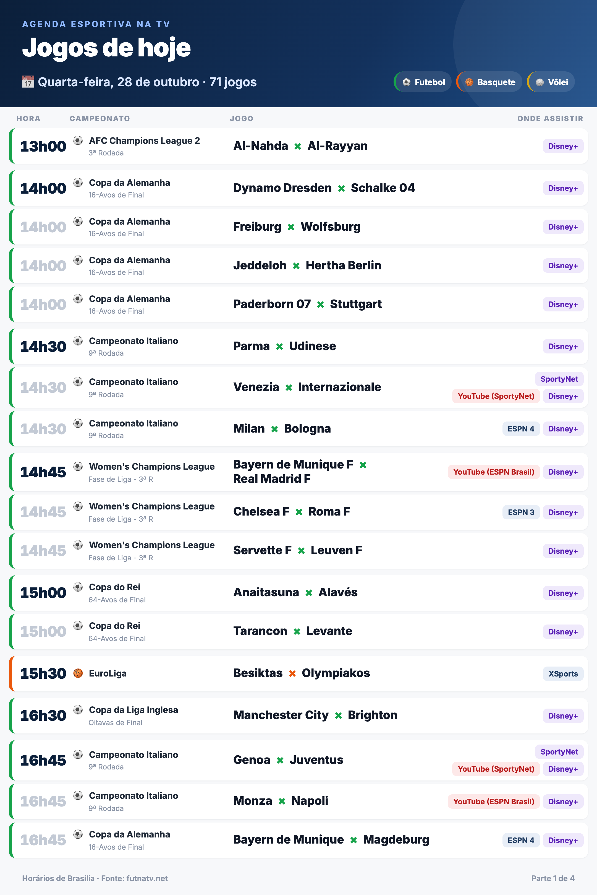

# 📅 Agenda esportiva do dia

Gera, todo dia às **5h (Brasília)**, a agenda de jogos transmitidos na TV e no streaming, com dados do [futnatv.net](https://futnatv.net): **futebol, basquete, vôlei e NFL**.

São dois formatos:

- **Imagens** prontas pra compartilhar em grupos e canais (WhatsApp, Telegram, Instagram...).
- **Página web** em que cada jogo tem um botão **"Salvar na agenda"**, que abre o Google Agenda já preenchido.

👉 **Página do dia:** https://o-bom-redator.github.io/agenda-esportiva/
👉 **Imagens do dia:** [Releases](https://github.com/o-bom-redator/agenda-esportiva/releases)

<p align="center"></p>

---

## Como funciona

```
GitHub Actions (todo dia às 5h)
   │
   ├─ scraper.js  → busca os jogos do dia na API do futnatv (por esporte e data)
   ├─ mensagem.js → aplica filtros (sem categorias de base) e monta a versão em texto
   ├─ imagem.js   → desenha a agenda em HTML e tira "foto" com o Chrome (Puppeteer)
   ├─ pagina.js   → gera a página com os links do Google Agenda e o arquivo .ics
   │
   ├─ Release "Agenda DD/MM" → imagens PNG + mensagem.txt (apaga a do dia anterior)
   └─ GitHub Pages           → página atualizada
```

O GitHub avisa por e-mail e no app quando sai a release nova. Se o aviso não chegar, ative em **Watch → Custom → Releases** no repositório.

### O que vai na agenda

- **Esportes:** jogos com transmissão confirmada de futebol, basquete (NBA, NBB, EuroLiga...), vôlei e NFL.
- **Público:** profissional masculino e feminino. Categorias de base (sub-17, sub-20, U21, juniores, youth...) ficam de fora.
- **Ordem:** por horário. A agenda de um dia vai das 6h até a madrugada seguinte, como numa grade de TV. Os jogos da madrugada (ex.: NBA 00h00) ficam no fim, marcados com a data real (ex.: "qui, 29/10"), e entram no Google Agenda nesse dia.
- **Imagens:** quando há muitos jogos, a agenda é dividida em várias imagens ("Parte 1 de 3").
- **Cores dos canais:**
  - 🔴 YouTube/CazéTV (grátis)
  - 🟣 streaming
  - 🔵 TV

### A página

- **Salvar na agenda:** cada jogo tem um botão que abre o Google Agenda com título, horário, campeonato e onde assistir.
- **Filtro:** dá pra mostrar só um esporte.
- **Todos de uma vez:** o arquivo **agenda.ics** adiciona todos os jogos de uma vez (iPhone, Outlook, Google).
- **Celular e modo escuro:** a página funciona bem no celular e no modo escuro.

Sugestão de legenda pra postar junto com as imagens:

> 📅 Jogos de hoje na TV! Quer salvar algum na agenda? Toque aqui: https://o-bom-redator.github.io/agenda-esportiva/

---

## Bot de gols (Telegram)

O bot manda os gols dos jogos do dia em GIF, com legenda pronta pro canal, de dois jeitos.

### Automático (goals.zone)

A cada minuto o bot consulta o [goals.zone](https://goals.zone), que junta os clipes de gol postados no r/soccer. Quando sai um gol num jogo da agenda do dia, ele baixa o vídeo, faz o GIF e te manda. Você não precisa fazer nada.

- **Quais jogos:** só os campeonatos de `avisos.campeonatos` no `config.json`. Pra usar uma lista diferente da dos avisos, crie `gols.campeonatos`. Pra desligar, use `"gols": { "automatico": false }`.
- **Vídeo no Reddit:** quando o clipe só existe no próprio Reddit (`v.redd.it`), o bot manda só a legenda, porque o Reddit bloqueia robôs.
- **Uso educado:** o bot faz 1 consulta por minuto e se identifica. Os termos do goals.zone não permitem republicar o conteúdo deles. Se o autor bloquear o acesso, o modo manual continua funcionando.

### Manual (colar o link)

Pra um gol que o automático não pegou, cole no bot o título e o link do vídeo:

```
Milan 2-[4] Bologna - Samuel Mbangula hat trick 86'
https://streamin.link/v/57b4f2a6
```

Nos dois modos, ele devolve:

- **Animação:** o vídeo sem som, que o Telegram mostra como GIF.
- **Legenda:** no formato do canal, com o campeonato e a rodada puxados da agenda do dia:
  ```
  🇮🇹 *Milan 2x4 Bologna* 🇮🇹
  ⚽ Samuel Mbangula (hat-trick) / 86'
  🏆 Campeonato Italiano | 9ª Rodada
  ```

No modo manual, se mandar só o link, ele faz o GIF e pede o título em seguida. Os detalhes em inglês viram português: OG → gol contra, penalty → pênalti, hat trick, free kick → falta, great goal → golaço.

**Links aceitos:** streamin.link / streamin.me, streama.in / streamain.com e qualquer link direto de `.mp4`, com ou sem `https://`.

### Onde o bot roda

No **GitHub Actions** (workflow `bot.yml`), em turnos de 6 h: **das 8h às 2h** (Brasília). Das 2h às 8h ele fica desligado. Mensagens mandadas nesse intervalo são respondidas quando o turno das 8h começa.

Pra mudar os horários, edite o `cron` e o `PARAR_AS` no `.github/workflows/bot.yml`. Quando tiver um servidor próprio, o bot roda direto lá com `node bot.js`, sem turnos.

### Configurar (uma vez)

1. No Telegram, abra o **@BotFather**, mande `/newbot` e escolha um nome. Ele te dá um **token**.
2. Descubra o seu número de chat: mande qualquer mensagem pro **@userinfobot** no Telegram. Ele responde com o seu `Id`.
3. No GitHub, vá em **Settings → Secrets and variables → Actions → New repository secret** e crie dois segredos:
   - `TELEGRAM_TOKEN`: o token do BotFather
   - `TELEGRAM_CHAT_ID`: o seu número de chat
4. Ligue o primeiro turno em **Actions → Bot de gols e avisos → Run workflow**. Os próximos ligam sozinhos.
5. No Telegram, abra o seu bot e mande `/start`.

**Pra testar no computador:** copie `.env.exemplo` pra `.env`, cole o token e rode `npm run bot`. Desligue o bot do GitHub antes (**Actions → Bot de gols e avisos → ··· → Disable workflow**), porque o Telegram não deixa dois bots iguais ligados ao mesmo tempo.

### Avisos de início de jogo

O mesmo bot te avisa **15 minutos antes** dos jogos principais, com o link de onde assistir, pra você colar no canal:

```
⏰ Daqui a 15 minutos, às 19h30, começa *Fluminense x Internacional* pelo Brasileirão - Série A.
📺 Transmissão: Record, Premiere e CazéTV

👉 Record: https://recordplus.com
👉 Premiere: https://globoplay.globo.com
👉 CazéTV: https://www.youtube.com/results?search_query=CazéTV+Fluminense+x+Internacional+ao+vivo
```

- **Agrupados:** jogos que começam no mesmo horário saem numa mensagem só.
- **Links:** levam pro site do canal (Disney+, Globoplay, HBO Max...). Quem tem conta já cai no ao vivo. Pros canais do YouTube, o link é uma busca pelo canal + jogo, que traz a live no topo. Os links ficam em `canais.js`, e dá pra trocá-los por links de afiliado no futuro.
- **Quais jogos:** só os campeonatos listados em `avisos.campeonatos` no `config.json`. O nome precisa ser igual ao do futnatv (ex.: `Brasileirão - Série A`, `Campeonato Italiano`, `NBA`). Com a lista vazia, avisa todos.
- **Antecedência:** `avisos.minutosAntes` (padrão 15).
- **Próximos avisos:** mande `/avisos` pro bot.
- **Sem perder aviso:** o bot relê a agenda a cada 2 horas, então pega mudanças de horário. Na troca de turno, ele lembra quais jogos já avisou. Se um turno começar atrasado, ainda avisa os jogos que não começaram, com os minutos que faltam.

**Alternativa no Mac:** o `./bot.sh` deixa o bot ligado no Mac (liga ao entrar e volta se cair), e `./bot.sh remover` desliga. Só funciona com o Mac ligado.

Os vídeos são das emissoras donas dos direitos. Use com moderação e sem fins comerciais.

---

## Gerar fora do horário

**No GitHub:** **Actions → Agenda do dia → Run workflow**, depois escolha `hoje`, `amanha` ou uma data (`2026-10-28`).

**No computador** (precisa do [Node.js](https://nodejs.org) 20 ou mais novo):

```bash
npm install
node gerar.js                  # jogos de hoje
node gerar.js --data amanha    # jogos de amanhã
node gerar.js --data 2026-10-28
```

As imagens ficam em `imagens/AAAA-MM-DD/` e a página em `site/`. No Mac, aparece uma notificação e a pasta abre sozinha.

---

## Configuração (`config.json`)

| Opção | O que faz |
|---|---|
| `esportes` | Quais esportes entram: `futebol`, `basquete`, `volei`, `nfl` |
| `ocultarBase` | `true` tira jogos de categorias de base (sub-17, sub-20, U21...) |
| `ocultarFemininos` | `true` tira jogos femininos |
| `ocultarCampeonatos` | Lista de campeonatos a esconder, ex. `["MLS", "Campeonato Saudita"]` |
| `jogosPorImagem` | Acima disso, divide em mais imagens (padrão 22) |
| `abrirPasta` | No Mac, abre a pasta das imagens ao terminar (padrão `true`) |
| `avisos.minutosAntes` | Quantos minutos antes do jogo o bot avisa (padrão 15) |
| `avisos.campeonatos` | Campeonatos que geram aviso, com o nome igual ao do futnatv. Vazio = todos |
| `gols.automatico` | `true` manda os gols sozinho (goals.zone). `false` deixa só o modo manual |
| `gols.campeonatos` | Opcional: campeonatos dos gols automáticos. Sem ela, usa a lista dos avisos |

Depois de alterar, faça commit e push pra que o GitHub use a versão nova.

---

## Arquivos

| Arquivo | Função |
|---|---|
| `gerar.js` | Script principal: busca, filtra, gera imagens, texto e página |
| `scraper.js` | Busca os jogos na API do futnatv |
| `mensagem.js` | Filtros e versão em texto (formato WhatsApp) |
| `imagem.js` | Layout e geração das imagens PNG |
| `pagina.js` | Página com links do Google Agenda e arquivo `.ics` |
| `bot.js` | Bot do Telegram que transforma o post de gol em GIF com legenda |
| `gols.js` | Lê o título do post do r/soccer, acha o jogo na agenda e monta a legenda |
| `goalszone.js` | Busca automática dos gols no goals.zone |
| `gif.js` | Baixa o vídeo do link e converte em GIF (ffmpeg) |
| `avisos.js` | Avisos de início de jogo |
| `canais.js` | Link de cada canal de transmissão |
| `bot.sh` | Deixa o bot ligado no Mac (launchd) |
| `.github/workflows/bot.yml` | Turnos do bot no GitHub Actions |
| `.github/workflows/agenda.yml` | Agendamento diário, release e GitHub Pages |
| `agendar.sh` | Alternativa: agendar no próprio Mac (launchd). Fica desligado |
| `enviar.js` | Alternativa: envio automático pra um grupo de WhatsApp (whatsapp-web.js, não oficial). Fica desligado |

---

## Observações

- **Origem dos dados:** os dados vêm do futnatv.net. Se o site mudar a API, a busca pode parar de funcionar, e o erro aparece na aba **Actions**.
- **Atraso:** o GitHub pode atrasar alguns minutos o horário agendado.
- **Duração dos eventos:** a duração dos jogos na agenda é estimada (futebol e vôlei 2h, basquete 2h30, NFL 3h30).
